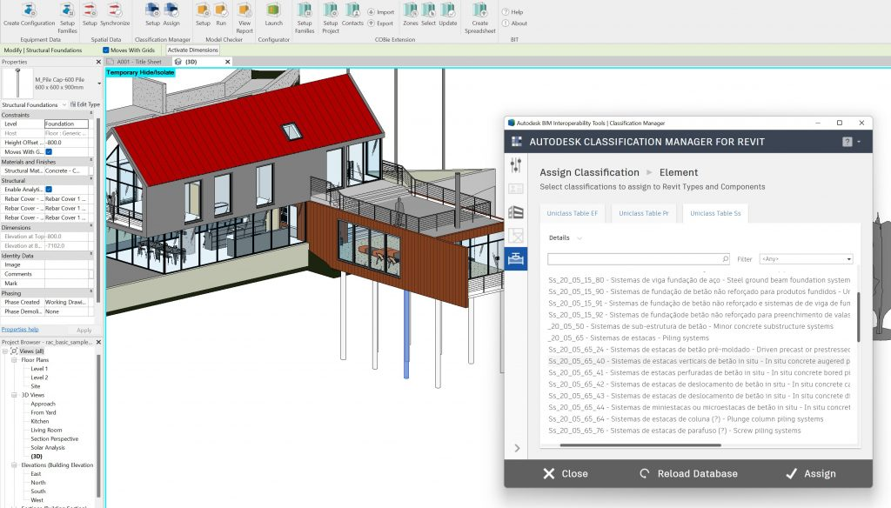

<nav class="toc" aria-label="Nesta página">
  <a href="#revit">Autodesk Revit</a>
  <a href="#archicad">Graphisoft Archicad</a>
  <a href="#ifc">Exportação para IFC</a>
  <a href="#uniformat">Uniformat II</a>
</nav>

<h2 id="revit">Tabelas para o Autodesk Revit</h2>

Pode classificar modelos BIM de forma expedita usando a ferramenta [Autodesk Standardized Data Tool for Revit](https://interoperability.autodesk.com/) (antigo BIM Interoperability Tools).

  <a class="btn" href="https://github.com/rresende/secclass/releases/download/V2.0/SECClasS_V2.0_AutodeskInteroperabilityTools.xlsx">Descarregar as tabelas SECClasS v2.0 para Revit (.xlsx)</a>

**Como usar:** descarregue o [manual de instruções](../docs/Guia_Utilizacao_SECClasS_BIT_v1.0.pdf) (Revit 2022) e veja os [vídeos no canal YouTube do SECClasS](https://youtube.com/playlist?list=PLijhXZogmBZxULushQjF2Y3ZE9T3QOXTw).

Também está disponível a [tabela Uniformat II em português para o Revit](#uniformat).

<h2 id="archicad">Tabelas para o Graphisoft Archicad</h2>

As tabelas da versão 2.0 do SECClasS estão disponíveis no formato de classificação do Archicad (XML).

  <a class="btn" href="https://github.com/rresende/secclass/releases/download/V2.0/SECClasS.V2.0.para.Archicad.xml">Descarregar as tabelas SECClasS v2.0 para Archicad (.xml)</a>

**Como usar:** veja o [vídeo com instruções para o uso das tabelas](https://youtu.be/0sLyCpoQGhI) (2021) no canal YouTube do SECClasS.

As tabelas no formato XML e o vídeo tutorial são fornecidos pela [Infor](https://www.infor.pt/), a quem agradecemos.

<h2 id="ifc">Exportação para IFC</h2>

Em actualização

O IFC (Industry Foundation Classes) é uma descrição digital normalizada do ambiente construído, incluindo edifícios e infraestruturas. É uma norma internacional aberta (ISO 16739-1:2018), independente do fornecedor de software, e o principal produto técnico da [buildingSMART International](https://www.buildingsmart.org/) para a promoção do openBIM®.

### Exportação de Revit para IFC

Para exportar para IFC um modelo já classificado no Revit, é necessário mapear os parâmetros de classificação. São necessários os ficheiros:

1. Ficheiro de configuração IFC para os parâmetros do SECClasS — [Secclass_IFC_ParameterSet_PT.txt](https://raw.githubusercontent.com/rresende/secclass/main/ClassificationFiles/IFC_files/Secclass_IFC_ParameterSet_PT.txt)
2. Ficheiro de configuração do projeto — [Secclass_Project_Parameter_PT.txt](https://raw.githubusercontent.com/rresende/secclass/main/ClassificationFiles/IFC_files/Secclass_Project_Parameter_PT.txt)
3. Ficheiro de configuração de layers — [Secclass_exportlayers-ifc-IAI.txt](https://raw.githubusercontent.com/rresende/secclass/main/ClassificationFiles/IFC_files/Secclass_exportlayers-ifc-IAI.txt)

Veja o [vídeo de exportação de Revit para IFC](https://www.youtube.com/watch?v=Kk3WEfh_lvo) no canal YouTube do SECClasS. O manual de instruções está a ser atualizado.

Para abrir ficheiros IFC (.ifc) é necessário um software compatível; existem vários, gratuitos e pagos. No exemplo apresentado usa-se o [Solibri Anywhere](https://www.solibri.com/solibri-anywhere) (gratuito).

### Exportação de Archicad para IFC

Veja o [tutorial em vídeo sobre a exportação de Archicad para IFC](https://www.youtube.com/watch?v=NLxMn_dsgM0&list=PLijhXZogmBZxKa6XdpLqFZLK3lGbrFP6S&index=10), em parceria com a [Infor](https://www.infor.pt/).

<h2 id="uniformat">Uniformat II em português</h2>

O Uniformat 2010 é uma estrutura de decomposição do trabalho (WBS — Work Breakdown Structure) que faz parte do [OmniClass](https://www.csiresources.org/standards/omniclass). É adequado para a elaboração de mapas de quantidades, podendo ser integrado em software de medição nas fases iniciais dos projetos, e está disponível nativamente no Revit. Tem apenas uma tabela de classificação de elementos de construção, pelo que não é um sistema de classificação tal como definido na norma ISO 12006-2.

  <a class="btn" href="https://github.com/rresende/secclass/releases/download/v1.0_uniformat/UniformatII_Portugues_V1.0.xlsx">Descarregar Uniformat II em português (.xlsx)</a>
  <a class="btn btn-outline" href="https://github.com/rresende/secclass/releases/download/v1.0_uniformat/UniformatII_Portugues_V1.0_AutodeskClassificationTools.xlsx">Uniformat II para o Revit (.xlsx)</a>

O Uniformat II está dividido em sete partes, num total de 654 entradas:

- A. Subestrutura
- B. Esqueleto e invólucro
- C. Interiores
- D. Instalações
- E. Equipamento e mobiliário
- F. Construção especial e demolições
- G. Trabalhos na envolvente

O ficheiro Excel tem duas folhas: `Uniformat_2010_EN` (versão original) e `Uniformat_2010_PT` (versão em português europeu). Para usar o Uniformat no Revit, descarregue a tabela para o Revit acima e siga as instruções da [secção Revit](#revit).

O Uniformat II é publicado pelo [Construction Specifications Institute](https://www.csiresources.org/standards/uniformat) e foi traduzido pela [Limsen Consulting](https://limsen.com/) em parceria com a [Lipronerg Engenharia](https://lipronerg.pt/), a quem agradecemos.

---

Comentários, sugestões ou correções: escreva para <a class="eml" href="#" rel="nofollow" data-e="dHAuc3NhbGNjZXNAb2ZuaQ==">info (arroba) secclass.pt</a>.
